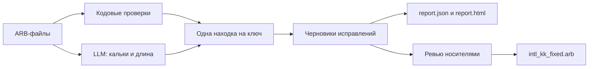

# locqa

Контроль качества локализации Flutter ARB: кодовые и статистические проверки, точечный LLM-анализ, ревью носителем и воспроизводимая сборка исправлений. Проект для Grand Mobile × Decentrathon 6.0.

## Как это работает



Файл сам служит эталоном: редкие варианты сравниваются с частыми, чтобы находить возможные опечатки и несогласованные термины. LLM подключается для смысловых проверок. Без ключа API доступны кодовые проверки.

## Установка и первый запуск

Это CLI-инструмент и локальная HTML-страница разметки: отдельный веб-сервер или запуск Flutter-приложения не нужны. Требуется Python 3.10+; Flutter SDK с командой `flutter` в PATH нужен для проверки генерации, Dart — для тестов бонусного пакета. Исходные данные кейса не входят в код.

Команды ниже рассчитаны на macOS/Linux и выполняются из корня репозитория:

```bash
git clone https://github.com/BAITC-Hacks/hack-8b9f1179-ninja-turtles.git
cd hack-8b9f1179-ninja-turtles
python3 -m venv .venv
source .venv/bin/activate
python -m pip install -e '.[dev]'
mkdir -p data
```

Если проект уже скачан, откройте его папку и начните с создания/активации `.venv`. В новом окне терминала повторите `source .venv/bin/activate`. На Windows окружение активируется командой `.venv\Scripts\Activate.ps1` в PowerShell.

Поместите выданные организаторами `intl_ru.arb`, `intl_kk.arb`, `intl_en.arb`, `intl_uz.arb` в `data/`, затем выполните:

```bash
locqa check --source data/intl_ru.arb --target data/intl_kk.arb \
  --glossary glossary.csv --no-llm --out out/report.json --review-dir out/review
python scripts/build_review_site.py
```

Откройте `out/report.html` для просмотра находок и `out/review_site/review.html` для разметки двойным щелчком в файловом менеджере. На macOS можно выполнить `open out/review_site/review.html`. Данные встроены в HTML, сервер не требуется.

Без закрытых данных можно проверить установку на синтетическом примере из репозитория:

```bash
locqa check --source tests/fixtures/localizations/intl_ru.arb \
  --target tests/fixtures/localizations/intl_kk.arb --no-llm --out out/demo/report.json
```

Без `--no-llm` используется модель, если настроены credentials; `--offline` читает только кэш. Рядом с отчётом создаются HTML и `.llm.json`: стоимость, полнота LLM-прохода и ошибки модулей. Неполный LLM-проход нельзя представлять как полный анализ. Настройки описаны в [LLM.md](LLM.md).

`check` поддерживает 11 типов: `untranslated`, `same_as_source`, `wrong_language`, `placeholder_mismatch`, `plural_mismatch`, `suffix_harmony`, `orthography`, `glossary_violation`, `inconsistent_term`, `length_overflow`, `machine_translation_suspect`. Бренды и устоявшиеся заимствования не требуют перевода. ICU допускает `other` без `one`. Имена, число вхождений обычных параметров, printf-параметры и теги защищены общим валидатором.

Смысловые кандидаты LLM первоначально идут на ревью отдельно от строгого отчёта. Финальная сборка включает подтверждённые человеком смысловые ошибки в `machine_translation_suspect`.

## Из разметки в проверенную сдачу

A/B/C — три части данных, а не три независимых носителя. Текущие 405 карточек проверил один носитель (`native_1`). Передавайте каждую часть ровно один раз.

На странице разметки выберите A, затем B и C. Для каждой строки нажмите «Верно», «Свой вариант», «Не ошибка» или «Не уверен(а)». После каждой части нажмите «Скачать результат». Прогресс хранится в браузере; скачанные CSV — вход для сборки. Число карточек нового запуска может отличаться от исторических 405: первый пример запускает только офлайн-проверки, а исходное ревью включало LLM-кандидатов.

Общий пример сборки для новых данных (замените `/path/...` реальными путями к скачанным CSV):

```bash
python scripts/finalize.py --source data/intl_ru.arb --target data/intl_kk.arb \
  --reviewed /path/review_A_done.csv /path/review_B_done.csv /path/review_C_done.csv \
  --reviewer native_1 --out-dir out/final --flutter
```

При необходимости `--overrides /path/agent_corrections.json` добавляет отдельный список объектов `key, text, issue_type, reason`. Такие исправления получают `x-reviewed: false`, `x-reviewer: agent_review`; они никогда не переопределяют утверждённую носителем правку. После явного подтверждения носителем объект `human_confirmation` с полями `reviewer`, точным `text`, `date` и `evidence` позволяет выставить `x-reviewed: true` и `x-reviewer: native_1`. `--cost-evidence out/final_split.log` сохраняет происхождение исторической оценки расходов, не делает API-запросов.

Сборка проверяет версии CSV относительно обоих ARB, отклоняет дубли частей и конфликтующие решения, сохраняет исходную разметку. Выход публикуется только после успешной проверки; предыдущая папка остаётся рядом как `final.previous-*`.

### Воспроизведение текущей сдачи

Для нашей исторической разметки нужны также четыре дополнительные подтверждённые правки: общий пример выше без них не воспроизводит итоговые 382 изменения и оставляет ошибку плейсхолдера. Распакуйте частный архив `grand-loc-results-PRIVATE.zip` в `out/reference/` (внутри появится `results/`), а исходные ARB организаторов поместите в `data/`. Не используйте исправленный ARB как исходный целевой файл.

```bash
python scripts/finalize.py --source data/intl_ru.arb --target data/intl_kk.arb \
  --reviewed out/reference/results/input_review_A_done-3.csv \
             out/reference/results/input_review_B_done-2.csv \
             out/reference/results/input_review_C_done-2.csv \
  --overrides out/reference/results/agent_corrections.json \
  --baselines out/reference/results/baselines.json \
  --reviewer native_1 --out-dir out/final --flutter
```

Это воспроизводит исправления и исходные метрики без LLM-запросов. Историческая оценка затрат остаётся в `out/reference/results/cost.json`; без исходного лога новая сборка не переносит её автоматически. Для переноса используйте `--cost-evidence` с сохранившимся логом.

В `out/final/`:

- `intl_kk_fixed.arb`: исходные игровые ключи, исправления и явные метки ревью;
- `report.json`, `report.html`: финальные находки и исправления;
- `decisions.csv`, `agent_decisions.csv`, `agent_corrections.json`: происхождение правок;
- `review_all_done.csv`, `input_*.csv`: неизменённые решения носителя;
- `metrics.json`, `precision_sample_100.csv`: метрики на исходных метках, seed 7;
- `structural_validation.json`, `manifest.json`: проверка всего файла, числа и SHA-256 входов;
- `cost.json`: расходы финализации и отдельно историческая оценка;
- `flutter/`: журнал обычного запуска, совместимые копии, карта ключей, сгенерированный Dart.

Текстовые пробелы на границах составных строк сохраняются. Компактные ARB, многострочные метаданные и повторяющиеся `@@comment` поддерживаются. Дубликаты игровых ключей исходной выгрузки перечисляются предупреждениями; эффективное значение — последнее, как у JSON/Flutter.

Низкоуровневые этапы тоже доступны:

```bash
python -m locqa.sheet import /path/review_A_done.csv /path/review_B_done.csv /path/review_C_done.csv \
  --source data/intl_ru.arb --out out/decisions.csv
locqa fix --source data/intl_ru.arb --target data/intl_kk.arb \
  --decisions out/decisions.csv --out out/intl_kk_fixed.arb
locqa validate --source data/intl_ru.arb --target out/intl_kk_fixed.arb \
  --original data/intl_kk.arb --out out/structural.json
```

Невалидная правка, сбой проверяющего модуля или провал `validate` дают ненулевой exit code. Обычные находки `check` не считаются сбоем процесса; используйте `validate` как строгий структурный барьер.

## Flutter: исходные ключи и совместимая копия

Исходный русский шаблон не проходит стандартный `flutter gen-l10n` из-за трёх идентификаторов. Проверка воспроизводит исходный отказ, затем переименовывает ключи **только в копиях обоих языков**:

| Игровой ключ | Ключ проверочной копии |
|---|---|
| `UNeedHelp` | `uNeedHelp` |
| `TowConfirmDesc` | `towConfirmDesc` |
| `inventoryEquipped@description` | `inventoryEquippedDescription` |

```bash
python scripts/validate_flutter.py --source data/intl_ru.arb --target out/final/intl_kk_fixed.arb \
  --original data/intl_kk.arb --out-dir out/flutter-check
```

Переименования проверяются на коллизии и сохраняются в `key_mapping.json`. Игровой ARB не теряет ключей. Успешный результат совместимой копии не означает, что исходный шаблон компилируется без адаптации. Все плейсхолдеры дополнительно проверяются до запуска Flutter: генератор сам может объединить ошибочные имена параметров.

## Результаты и их границы

Сохранённая человеческая разметка: 405 кандидатов; 378 подтверждений, 24 отклонения, 3 неопределённых решения. Доля подтверждений среди определённых — **94,03%**. Случайная выборка 100 из этого же пула (seed 7): **95/100**. Это повторное использование существующих меток; выборка включает смысловые кандидаты и не является независимым скрытым тестом.

В текущей частной сдаче четыре дополнительные агентские правки подтверждены тем же носителем 31 октября 2026 года. Подтверждения точного текста сохранены в `agent_corrections.json`; первоначальные CSV и метрики не переписываются. Все **382 изменённых значения проверены человеком**, ожидающих подтверждения нет.

Синтетический recall измеряется отдельно: 11 вариантов мутаций покрывают **7 типов ошибок**, не все 11 типов кейса. Актуальный полный офлайн-baseline: 95% (94–96%) на seeds 7,11,23. Результаты и точный состав детекторов см. [методологию](docs/methodology.md). Recall на подложенных организаторами ошибках неизвестен.

```bash
python scripts/compare_baselines.py --source data/intl_ru.arb --target data/intl_kk.arb \
  --glossary glossary.csv --en data/intl_en.arb --uz data/intl_uz.arb \
  --seeds 7,11,23 --out out/baselines.json
python scripts/precision_sample.py score out/final/precision_sample_100.csv
```

Глоссарий и исключения уточнялись на этих данных, поэтому текущие метрики не являются оценкой на отложенной выборке. Историческая стоимость $7.0484 из сохранённого лога — оценка одного прохода с кэшем, не общий счёт провайдера. Финализация выполняется офлайн, новых платных запросов не делает.

## Проверки, CI и бонусы

```bash
python -m pytest -q
python scripts/validate_tracked_arb.py
(cd integrations/flutter/kk_affix && dart run test/parity_test.dart)
```

GitHub Action `.github/workflows/locqa.yml` запускает тесты и проверяет пары ARB на PR; секреты и API не нужны. Для закрытых данных полный Flutter-прогон выполняется локально командой выше.

Бонусы: `scripts/run_uz.py` (структурная проверка uz), `scripts/translit_kk.py` (выбранная таблица казахской латиницы), Dart/Python `kk_affix` (343 общих вектора). Транслитерация экспериментальная: текущий юридический статус алфавита не заявляется. Для узбекского отсутствует отдельная полная лингвистическая модель.

## Упаковка

```bash
python scripts/package_submission.py --final-dir out/final --out-dir out/submission
```

Создаются архив кода и **отдельный частный** архив результатов для организаторов, плюс SHA-256. Данные кейса, CSV и производные отчёты не должны попадать в публичный репозиторий. Упаковка включает незакоммиченные исходники и ничего не коммитит, не пушит и не отправляет.

Упаковка требует Git-репозиторий и успешную сборку с `--flutter`; поэтому для разработки клонируйте репозиторий. Передайте ссылку на репозиторий или `out/submission/locqa-source.zip`, а организаторам отдельно — `out/submission/grand-loc-results-PRIVATE.zip` и `SHA256SUMS.json`. Частный архив содержит отчёты JSON/HTML, исправленный ARB, глоссарий, методологию, разметку и результаты проверок.

Если упаковка сообщает, что файл изменился после проверки, заново выполните `finalize.py` и упаковку: не правьте файлы внутри `out/final/` вручную. Для отдельной повторной проверки Flutter выше используется `out/flutter-check/`, чтобы не менять проверенную сдачу.
