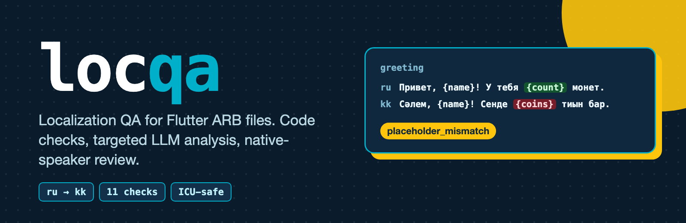
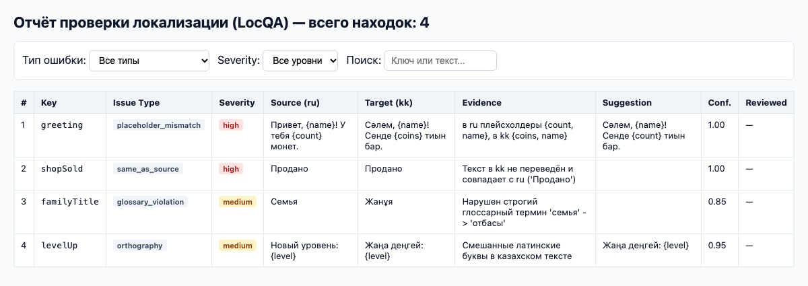
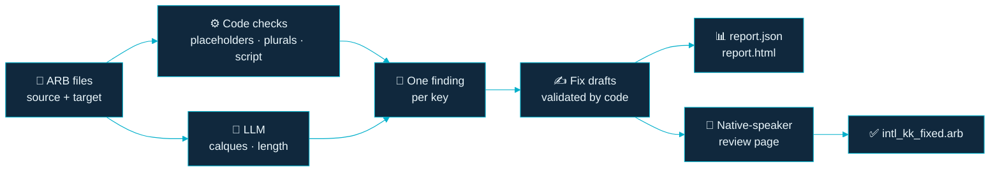
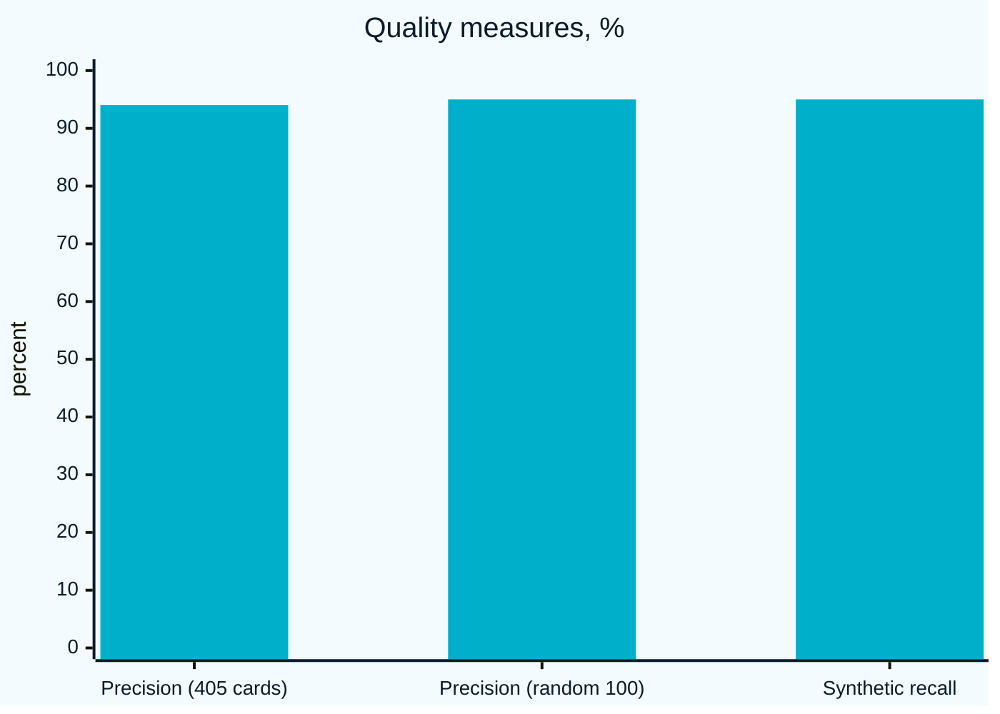

<div align="center">



# locqa: find what's wrong with a translation before players do

**Code checks, targeted LLM analysis and native-speaker review for Flutter ARB files, with a reproducible fix build.**

<p align="center">
  <a href="https://github.com/astmirzhan/Grand-Mobile-Decentrathon-6.0/actions/workflows/locqa.yml"></a>
  
</p>

<p align="center">
  
  
  
  
  
</p>

<p align="center"><a href="README.ru.md">Читать по-русски</a></p>

</div>

---

## 🧭 What it is

Game localizations break in quiet ways: a placeholder is renamed, a Russian word stays in the Kazakh file, a Latin `e`
slips into a Cyrillic word, a plural form is missing. **locqa** compares a target ARB file with its source, finds these
problems, drafts fixes and builds a corrected file that a native speaker has signed off.

| | |
| --- | --- |
| **Who it's for** | Teams shipping a Flutter app in Russian and Kazakh (Uzbek has a structural check too) |
| **What it does** | 11 kinds of checks, one finding per key, fix drafts, a review page for native speakers |
| **What it won't do** | Claim an incomplete LLM pass is a full analysis. The report says what was and wasn't checked |
| **Works without keys** | Yes. Code checks run offline with `--no-llm`. The LLM adds meaning checks |

The file is its own reference: rare variants are compared with frequent ones, so likely typos and inconsistent terms
stand out. The LLM is used only where code cannot decide (calques, length overflow, wrong meaning).

## 🖥️ What a report looks like

Checking the synthetic pair in [`docs/demo`](docs/demo) with `--no-llm`:



Each row has the key, both texts, the evidence, a suggested fix and a confidence value. Filter by issue type or severity.

## 🗺️ How it works



## 🔎 The 11 checks

| Check | Catches |
| --- | --- |
| `untranslated` | Missing or empty translation |
| `same_as_source` | Text left identical to the source (brands and set loanwords are exempt) |
| `wrong_language` | Russian or Uzbek text inside the Kazakh file |
| `placeholder_mismatch` | Lost, renamed or changed `{name}`, numbers, printf parameters and tags |
| `plural_mismatch` | Broken ICU plural structure (`other` without `one` is allowed) |
| `suffix_harmony` | A fixed Kazakh suffix after a placeholder that breaks vowel harmony |
| `orthography` | Russian letters instead of Kazakh ones, Latin look-alikes in Cyrillic words |
| `glossary_violation` | A strict term translated differently from [`glossary.csv`](glossary.csv) |
| `inconsistent_term` | A rival synonym for a term the file uses consistently |
| `length_overflow` | Text too long for its UI slot (LLM) |
| `machine_translation_suspect` | Word-for-word calques (LLM) and confirmed meaning errors |

## 📏 Results, and what they don't prove

On the real hackathon data (private, not in this repository):



| Measure | Value | Honest reading |
| --- | --- | --- |
| Human review | 405 candidates: 378 confirmed, 24 rejected, 3 unsure | **94.03%** confirmed among decided ones |
| Random sample (seed 7) | **95 / 100** | Reuses the same labels, so it is not an independent hidden test |
| Synthetic recall | **95%** (94-96%) over seeds 7, 11, 23 | Covers 7 of the 11 error types, not all |
| Fixed values | **382** changed, all checked by a native speaker | None are waiting for confirmation |

The glossary and exceptions were tuned on this data, so these numbers are not a held-out estimate. Recall on errors
planted by the organizers is unknown. More in [`docs/methodology.md`](docs/methodology.md) and
[`docs/verification.md`](docs/verification.md).

## 🚀 Try it in 2 minutes

Needs Python 3.10+. No keys, no Flutter, no private data.

```bash
git clone https://github.com/astmirzhan/Grand-Mobile-Decentrathon-6.0.git
cd Grand-Mobile-Decentrathon-6.0
python3 -m venv .venv && source .venv/bin/activate
python -m pip install -e '.[dev]'

locqa check --source docs/demo/intl_ru.arb --target docs/demo/intl_kk.arb \
  --glossary glossary.csv --no-llm --out out/demo/report.json
open out/demo/report.html          # xdg-open on Linux
```

You should see 4 findings. With your own files, put them in `data/` (ignored by git) and run the same command.
LLM mode needs a key: copy [`.env.example`](.env.example) to `.env`, then drop `--no-llm`. Use `--offline` to read only
the cache. Details in [`LLM.md`](LLM.md).

## 👤 From review to a verified file

1. `python scripts/build_review_site.py` builds `out/review_site/review.html`: one file, opens with a double click, no
   server, progress saved in the browser.
2. A native speaker marks each card **Correct**, **Own variant**, **Not an error** or **Unsure** and downloads the CSV.
3. `python scripts/finalize.py ... --reviewer native_1 --out-dir out/final --flutter` validates the CSVs against both
   ARB files, applies the fixes and writes `intl_kk_fixed.arb`, reports, metrics and a manifest with SHA-256 of inputs.

The build rejects duplicated parts and conflicting decisions, keeps the original markup and publishes the output only
after validation passes. Agent-made fixes are marked `x-reviewed: false` and never override a human edit. The full
step-by-step guide, including reproducing the historical submission, is in [`README.ru.md`](README.ru.md).

## 🧱 Flutter, honestly

The source Russian template does not pass the standard `flutter gen-l10n` because of three identifiers
(`UNeedHelp`, `TowConfirmDesc`, `inventoryEquipped@description`). `scripts/validate_flutter.py` reproduces that
failure, then renames the keys **only in compatibility copies** of both files and keeps a `key_mapping.json`. The game
ARB keeps every original key. A passing copy does not mean the original template compiles without adaptation.

## ✅ Quality

| Check | What it covers | Result |
| --- | --- | --- |
| `python -m pytest -q` | checks, glossary, Kazakh rules, plurals, LLM branches with mocked replies, review site, release safety | 133 tests (verified 31 Oct 2026) |
| `python scripts/validate_tracked_arb.py` | structure of every tracked ARB file | in CI |
| `dart run test/parity_test.dart` | Dart and Python `kk_affix` give the same answers | 343 / 343 vectors |
| GitHub Actions | installed CLI outside the checkout, tests, tracked ARBs, demo check and validate | [`locqa.yml`](.github/workflows/locqa.yml) |

The live paid LLM run was not repeated after the final review; LLM branches are covered with mocked replies.

## 🎁 Bonus tools

- [`scripts/run_uz.py`](scripts/run_uz.py): structural check for Uzbek.
- [`scripts/translit_kk.py`](scripts/translit_kk.py): Kazakh Latin transliteration, **experimental**: no claim about the
  legal status of the alphabet.
- [`integrations/flutter/kk_affix`](integrations/flutter/kk_affix): a Dart package with the same Kazakh affix logic as
  the Python side.

## 🗂️ Repository map

```
locqa/            the package: checks/, lang/ (Kazakh rules), llm.py, fix.py, validation.py, report.py
scripts/          finalize, review site, baselines, precision sample, Flutter validation, packaging
integrations/     Flutter kk_affix package
tests/            pytest suite and synthetic fixtures
docs/             methodology, Kazakh notes, verification, demo ARBs, README images
glossary.csv      strict and allowed terms · brands.txt: names that stay untranslated
```

## 🔒 Data and privacy

The organizers' ARB files, review CSVs and derived reports are private and git-ignored (`data/`, `out/`, `*.arb`). Only
the synthetic fixtures in `tests/fixtures` and `docs/demo` are tracked. `scripts/package_submission.py` builds a source
archive and a separate private results archive with checksums, and never commits or pushes anything.

## 👥 Team

Built at Grand Mobile × Decentrathon 6.0 by:

- [@astmirzhan](https://github.com/astmirzhan)
- [@xJam-byte](https://github.com/xJam-byte)
- [@birxnm](https://github.com/birxnm)

<div align="center">

**locqa** · built for Grand Mobile × Decentrathon 6.0 · one finding per key, a human on every fix 🛡️

</div>
