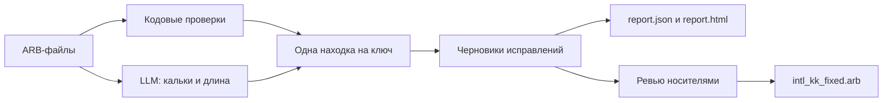

# locqa

Инструмент контроля качества локализации для Flutter ARB-файлов. Находит ошибки перевода, предлагает исправления и собирает исправленный файл только из правок, которые утвердил человек.

Сделан для кейса Grand Mobile × Decentrathon 6.0 «Qazaq Loc QA». Работает на любом ARB, сильнее всего — на казахском.

## Как это работает



Файл сам служит эталоном: подложенная ошибка — это точечное искажение в согласованном тексте, поэтому редкий вариант рядом с частым виден статистически. LLM подключается только там, где нужен смысл. Без ключа API инструмент работает на кодовых проверках.

## Быстрый старт

Нужен Python 3.10+.

```bash
pip install ".[dev]"

locqa check --source intl_ru.arb --target intl_kk.arb --glossary glossary.csv --out report.json
```

Рядом с `report.json` появятся `report.html` и `report.llm.json` с токенами и стоимостью LLM. Файлы `intl_en.arb` и `intl_uz.arb` рядом с исходником подхватываются сами, с ними проверки точнее.

| Флаг | Что делает |
|---|---|
| без флагов | с LLM, если есть ключ в `.env` |
| `--no-llm` | только кодовые проверки, без запросов |
| `--offline` | только готовые ответы из кэша |
| `--review-dir out/review` | таблицы для носителей |

## Какие ошибки находит

| Тип | Как ловим |
|---|---|
| `untranslated` | ключа нет или значение пустое |
| `same_as_source` | перевод совпадает с ru, кроме брендов, имён и чисел |
| `wrong_language` | совпадение с узбекским, латиница вместо кириллицы |
| `placeholder_mismatch` | `{имена}` не совпадают с ru |
| `plural_mismatch` | сломанные ICU-формы множественного числа |
| `suffix_harmony` | аффикс приклеен к плейсхолдеру: `{name}-ға` |
| `orthography` | редкое слово рядом с частым вариантом, латиница внутри кириллицы |
| `glossary_violation` | термин из ТЗ переведён не по глоссарию |
| `inconsistent_term` | термин переведён не так, как в остальном файле |
| `length_overflow` | короткий элемент длиннее и ru, и uz; повторяющийся дописанный хвост |
| `machine_translation_suspect` | калька: LLM, плюс подменённые имена и числа кодом |

Находки вида «перевод означает другое» в типах кейса нет, поэтому они идут носителям, но не в `report.json`.

## От находок к исправленному файлу

```bash
# 1. таблицы и сайт разметки
locqa check --source intl_ru.arb --target intl_kk.arb --glossary glossary.csv --out out/report.json --review-dir out/review
python scripts/build_review_site.py   # читает data/ и out/review, собирает out/review_site/review.html

# 2. носители размечают review.html и присылают review_A_done.csv, review_B_done.csv, review_C_done.csv

# 3. решения и исправленный файл
python -m locqa.sheet import review_*_done.csv --source intl_ru.arb --out out/decisions.csv
locqa fix --decisions out/decisions.csv --target intl_kk.arb --source intl_ru.arb --out intl_kk_fixed.arb
```

`fix` меняет только утверждённые строки, сохраняет порядок и разделы `@@comment`, отклоняет правки со сломанными плейсхолдерами и ставит у каждой изменённой строки метку `x-reviewed`.

## Метрики

Измеряем сами, потому что валидационной выборки нет.

- **Recall:** мутационный тест вносит известные ошибки и проверяет, найдены ли они с правильным типом: `python scripts/mutate_kk.py --source intl_ru.arb --target intl_kk.arb --glossary glossary.csv --seed 7`. Результаты в `docs/methodology.md`.
- **Precision:** ручная разметка, `python scripts/precision_sample.py score review_A_done.csv`. Цифры появятся после ревью носителями.

## Известные ограничения

- Исходный `intl_ru.arb` клиента не проходит `flutter gen-l10n`: ключи `UNeedHelp`, `TowConfirmDesc` и `inventoryEquipped@description` недопустимы для Flutter. Без этих трёх ключей в шаблоне файл с исправлениями собирается.
- Точность зависит от модели, в отчёте использованы ответы нескольких моделей: см. `docs/methodology_llm.md`.

## Бонусы

- `scripts/run_uz.py` — кодовая часть проверки узбекского.
- `scripts/translit_kk.py` — транслитерация в казахскую латиницу с проверкой длины.
- `suggest` предлагает переформулировку для строк с аффиксом после плейсхолдера.

## Документация и тесты

- `docs/methodology.md` — казахские проверки, глоссарий, метрики.
- `docs/methodology_llm.md` — смысловые проверки, модели, стоимость.
- `LLM.md` — настройки и модули LLM-части.

```bash
python -m pytest
```

Данные кейса в репозиторий не входят: условия запрещают их публиковать.
